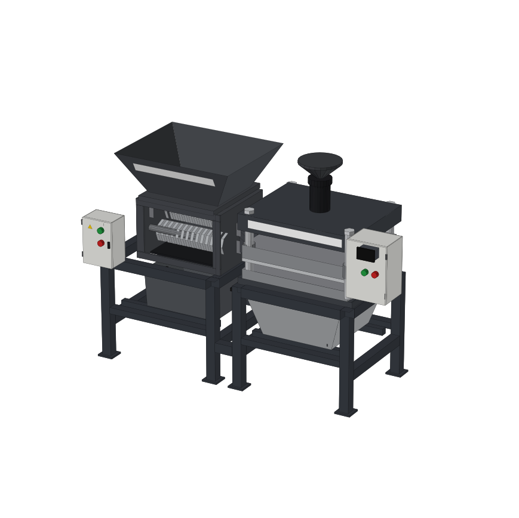

# Plastic Shredder

CAD drawings and an interactive 3D viewer for a plastic shredder + heat press prototype.

**Live 3D viewer:** https://jericwin.github.io/Plastic-Shredder/



## Files

| File | What it is |
| --- | --- |
| `prototype.jpeg` | Reference photo of the prototype |
| `prototype.dxf` | 2D general arrangement (front, top, right side views) with numbered balloons, control panel details A/B and component list, black and white |
| `prototype_color.dxf` | Same drawing with true-to-colour fills; lines and text black |
| `prototype_3d.dxf` | True-to-colour 3D model (MESH entities) |
| `index.html` / `prototype_3d_viewer.html` | Web 3D viewer: numbered part tags, parts list with control panel components (C1–C19), exploded view with opening panel doors, measuring tool, dimensions, section cut |
| `make_prototype_dxf.py` | Generates the 2D drawings |
| `make_prototype_3d.py` | Generates the 3D DXF and the web viewer (uses `viewer_template.html`) |

## Part numbers

Balloons 1–15 on the drawing match the parts list and the tags in the 3D viewer. Parts 12 and 13 are the two control panels; what is on their doors and inside them is numbered C1–C9 (shredder panel) and C10–C19 (heat press panel), shown in details A and B of the drawing. The parts inside the panels are typical wiring, assumed because they are not visible in the photo.

All units are millimetres. **Dimensions are estimated from the photo** (overall about 2000 × 700 × 1395 mm); verify against the real machine before fabrication.

## Opening in AutoCAD

- DXF files open directly; use *Save As → DWG* if you need a `.dwg`.
- 3D: `VSCURRENT` → *Realistic* to see colours, `ZOOM` → `E` if the model is off screen, `CONVTOSOLID` to turn the meshes into solids.

## Regenerating

Requires Python 3 and `ezdxf` (`pip install ezdxf matplotlib`).

```bash
python make_prototype_dxf.py prototype.dxf                    # 2D, black and white
python make_prototype_dxf.py prototype_color.dxf --color      # 2D, colour fills
python make_prototype_3d.py prototype_3d.dxf prototype_3d_preview.png   # 3D + viewer + index.html
```
